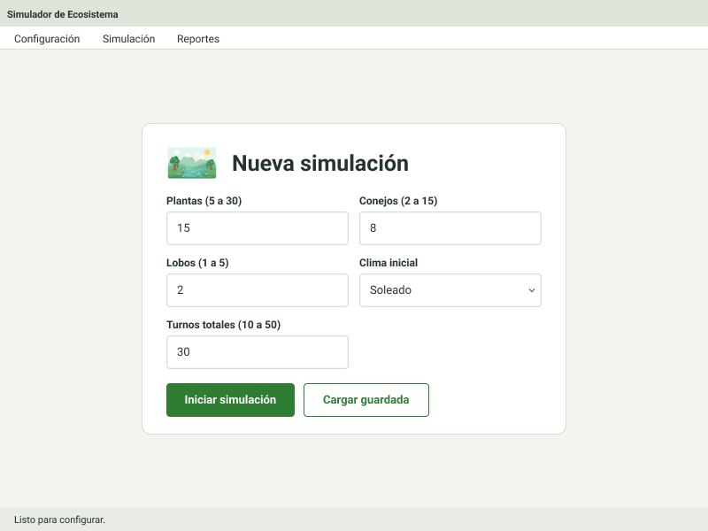
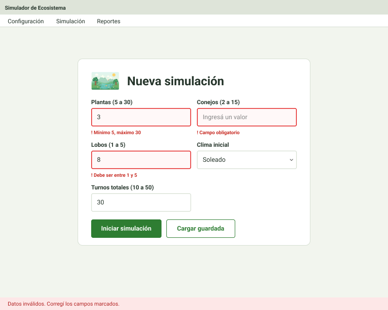
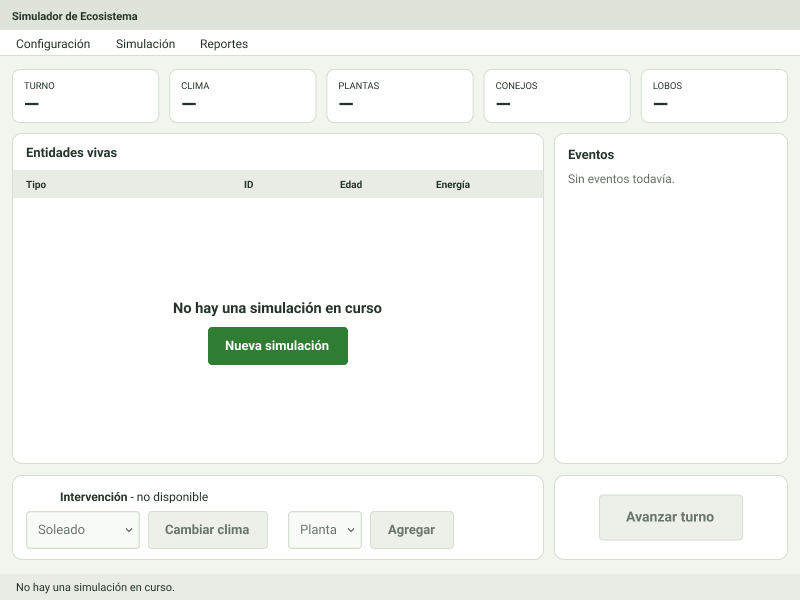
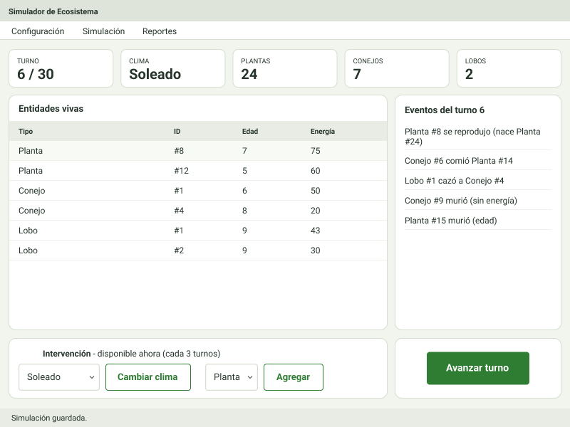
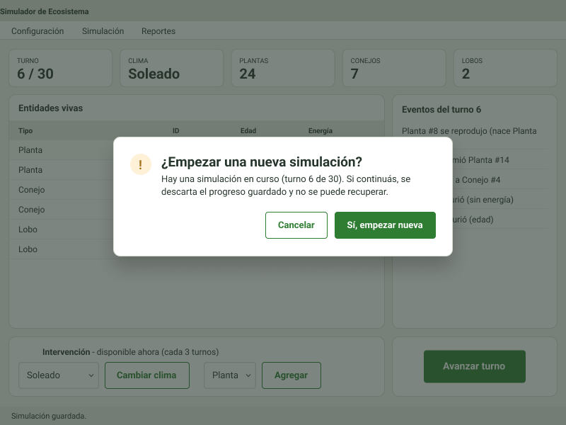
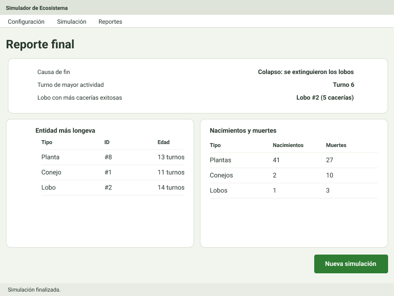

# Simulador de Ecosistema · Versión Swing

Segunda instancia evaluativa de **Interfaz Gráfica** (Analista de Sistemas).
Transformamos el simulador de ecosistema de la primera instancia, que corría en consola, en una aplicación de
escritorio **Java Swing** con arquitectura **MVC + DAO**, guardado de la partida en un archivo de texto y una
interfaz basada en nuestro diseño de Figma.

## Cómo ejecutarlo

**Requisitos**

- **Apache NetBeans 28** (proyecto _Java with Ant_).
- **JDK 17 o superior** (el proyecto compila con _source/target_ 17).
- No usa librerías externas.

**Pasos**

1. Clonar el repositorio:
   `git clone https://github.com/amsuppi/parcial-dos-interfaz-graficas.git`
2. En NetBeans: **File → Open Project** y elegir la carpeta `SimuladorEcosistema`.
3. Ejecutar con **Run Project (F6)**. La clase principal es `principal.Main`.

La partida se guarda automáticamente en `SimuladorEcosistema/datos/simulacion.txt` (ruta relativa, se crea sola).
Al volver a abrir la aplicación, la simulación continúa donde quedó. Para empezar de cero se usa
**Configuración → Nueva simulación**.

## Cómo se juega

1. **Configuración:** cantidad de plantas (5 a 30), conejos (2 a 15) y lobos (1 a 5), clima inicial y turnos
   totales (10 a 50).
2. **Simulación:** se avanza turno a turno y se ven los indicadores, la tabla de entidades vivas y los eventos del turno.
   Cada **3 turnos** se puede intervenir una vez: cambiar el clima o agregar una entidad (máximo 5 lobos en toda la
   simulación).
3. **Reporte final:** al completarse los turnos o si colapsa el ecosistema se muestra la causa de fin, el turno de
   mayor actividad, la entidad más longeva de cada tipo, el lobo con más cacerías y los nacimientos y muertes por tipo.

## Estructura del proyecto

```
SimuladorEcosistema/
├── datos/simulacion.txt        ← partida guardada (lo genera el DAO)
└── src/
    ├── principal/   Main: crea el DAO, la ventana y el controlador, los conecta y muestra la ventana
    ├── modelo/      Reglas de la simulación (Entidad, Animal, Planta, Conejo, Lobo, interfaces Mortal y
    │                Reproducible, Clima, Ecosistema) y cálculo del reporte (Reporte). Sin Swing ni consola.
    ├── vista/       Pantallas hechas con el diseñador de NetBeans: VentanaPrincipal (JFrame con CardLayout
    │                y barra de menú), PanelConfiguracion, PanelSimulacion y PanelReporte.
    ├── controlador/ SimulacionController: recibe las acciones de la vista, valida, coordina modelo y DAO
    │                y le entrega a la vista los datos actualizados. Sin Swing.
    └── dao/         SimulacionDAO: guarda y reconstruye el estado completo de la simulación en un .txt.
```

## Integrantes y rol

| Integrante                 | Rol                                                                                                                                                                   |
| -------------------------- | --------------------------------------------------------------------------------------------------------------------------------------------------------------------- |
| **Federico Manuel Calvar** | Migración a NetBeans y estructura MVC, adaptación del modelo, controlador, pantallas de Configuración y Simulación, barra de menú y confirmación de nueva simulación. |
| **Luciana Vargas Bustos**  | Capa DAO: guardado y carga de la simulación en archivo de texto, con manejo de archivo inexistente o con datos inválidos.                                             |
| **Amalia Maribel Suppi**   | Reporte final: cálculos en el modelo (`Reporte`) y pantalla `PanelReporte`.                                                                                           |

## Diseño en Figma

**01 · Configuración**



**02 · Configuración con error**



**03 · Simulación sin datos**



**04 · Simulación en curso**



**05 · Confirmación de nueva simulación**



**06 · Reporte final**



## Video explicativo

El video está en esta carpeta de Google Drive: **[Video y prompts del grupo](https://drive.google.com/drive/folders/17-aPBSgjnVQNpufA2UPKMACngNUWNEKI?usp=sharing)**

## Desafíos encontrados

- **Migración desde IntelliJ:** la IE1 estaba hecha en IntelliJ; creamos un proyecto nuevo en NetBeans y copiamos el `src`.
- **Versión de Java:** el diseñador visual no podía cargar los paneles porque el proyecto compilaba para una versión
  más nueva que la de NetBeans. Lo resolvimos fijando el proyecto en Java 17.
- **Sacar la consola del modelo:** el modelo imprimía todo con `System.out`; lo cambiamos para que devuelva los
  eventos y los datos, y que sea la vista la que los muestre.
- **Propiedades que NetBeans descartaba al guardar** (las que coinciden con su valor por defecto), lo que hacía que la
  app se viera distinta al diseño. Ajustamos esos valores.
- **Guardar el estado completo:** para que la partida y el reporte continúen sin perder datos hubo que guardar también
  las entidades muertas, los contadores y el historial por turno.
- **Coherencia visual** entre pantallas hechas por distintas personas: unificamos la paleta de colores.

## Uso de IA y herramientas externas

Usamos **Claude** (Anthropic) como asistente para planificar la división del trabajo en capas, revisar que cada
capa cumpliera las reglas de la consigna, resolver problemas de configuración de NetBeans y la implementación de los métodos.

### Prompts utilizados
Los prompts de cada integrante están en la carpeta [`docs/prompts`](docs/prompts) de este repositorio:

| Integrante                 | Documento                                                                                                                  |
| -------------------------- | -------------------------------------------------------------------------------------------------------------------------- |
| **Federico Manuel Calvar** | [prompts-fede.docx](docs/prompts/prompts-fede.docx)                                                                        |
| **Luciana Vargas Bustos**  | [prompts-dao-luciana.docx](docs/prompts/prompts-dao-luciana.docx) · [Como-lo-armamos-luciana.docx](docs/prompts/Como-lo-armamos-luciana.docx) |
| **Amalia Maribel Suppi**   | [prompts-maribel.docx](docs/prompts/prompts-maribel.docx)                                                                  |

También están en la misma carpeta de Google Drive que el video:
**[Video y prompts del grupo](https://drive.google.com/drive/folders/17-aPBSgjnVQNpufA2UPKMACngNUWNEKI?usp=sharing)**
